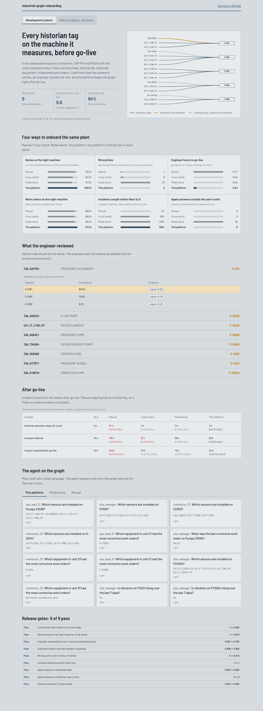
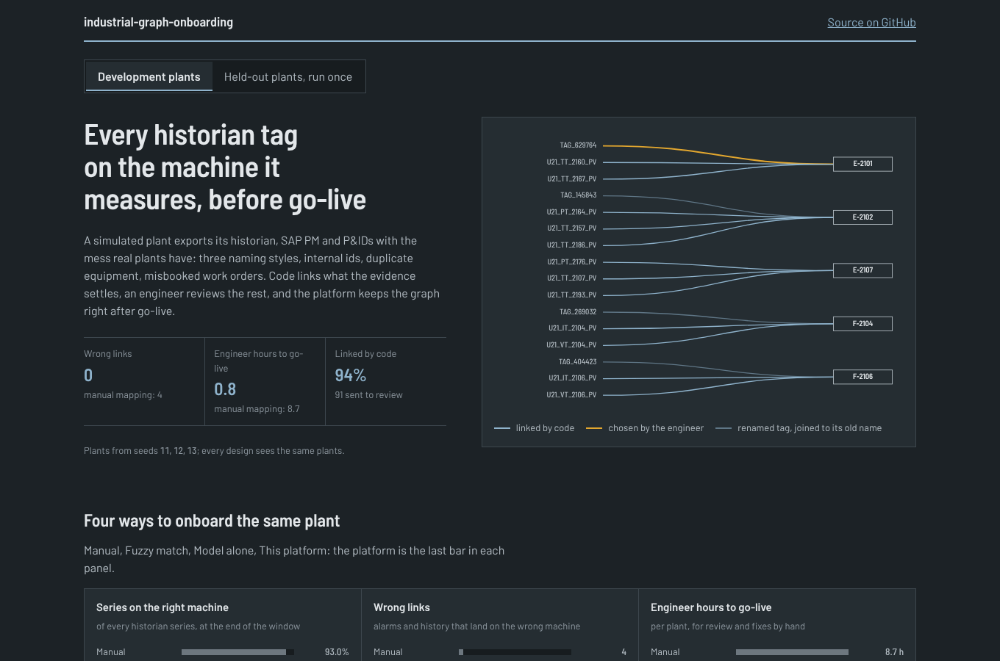
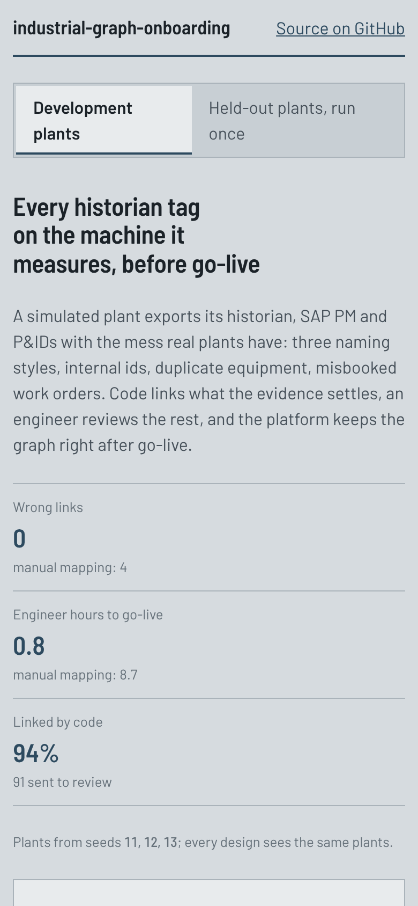

# industrial-graph-onboarding

**Onboarding a heavy-asset plant into an industrial knowledge graph, measured against how it is done by hand.**

A new site arrives as three exports: a historian with a few hundred tags named three different ways, an SAP PM
equipment master with duplicates and misbooked work orders, and a P&ID tag list read by OCR. This repository turns
them into one contextualized graph:

```
 historian ──┐                                   Unit ─contains→ Machine ─measured_by→ TimeSeries
 SAP PM    ──┼─→ grammar → evidence → decide ─→         Machine ─has_activity→ WorkOrder
 P&ID list ──┘   (config)  (name, P&ID,  (auto |        Record ─same_machine_as→ Machine
                            text, signal) engineer)     TimeSeries ─continues→ TimeSeries
```

Then it runs the site: the graph is deployed as configuration through CI (`igo plan` / `igo apply`, idempotent),
monitored against SLAs with an owner for every alert, watched for machines that are degrading, and queried by a
maintenance agent (and any MCP client) that answers only within the asker's units and cites the graph ids it used.

Every number below is scored against a simulated plant whose truth the platform never sees. Each design onboards the
same plant with the same engineer, the same model mistakes and the same incidents.

## Results

<!-- results:start -->

_Generated from `reports/*.json` by `igo report`; do not edit by hand._

**Development plants** (seeds [11, 12, 13]; 604 historian series, 169 machines, 240 agent questions)

| Design | Series on the right machine | Wrong links | Engineer hours to go-live | Go-live (days) | Duplicate records merged | Work orders on the right machine | Incidents caught in SLA | Failures warned 2-21 days ahead | Agent answers right | Answers outside the user's units |
|---|---:|---:|---:|---:|---:|---:|---:|---:|---:|---:|
| Manual onboarding: a spreadsheet lookup for standard names, an engineer maps the rest by hand | 93.0% | 4 | 8.7 | 4.0 | 0 of 11 | 88.6% | 0% | 35 of 41 | 92.1% | 0 |
| Fuzzy name matching, accepted without review | 84.6% | 8 | 0.0 | 0.0 | 0 of 11 | 88.6% | 96% | 30 of 41 | 80.0% | 0 |
| A model reads names and descriptions and links them; agent without checks | 81.5% | 97 | 0.0 | 0.0 | 0 of 11 | 88.6% | 100% | 29 of 41 | 59.6% | 25 |
| **industrial-graph-onboarding** | 100.0% | 0 | 0.8 | 1.0 | 10 of 11 | 97.6% | 100% | 38 of 41 | 98.3% | 0 |

Gates: all 9 pass.

Manual onboarding also costs the engineer 16.0 hours per plant answering the same 80 questions by hand; the agent answers them from the graph.

**Each safeguard removed on its own** (development plants)

| Design | Series on the right machine | Wrong links | Engineer hours to go-live | Go-live (days) | Duplicate records merged | Work orders on the right machine | Incidents caught in SLA | Failures warned 2-21 days ahead | Agent answers right | Answers outside the user's units |
|---|---:|---:|---:|---:|---:|---:|---:|---:|---:|---:|
| Without signal correlation | 99.8% | 1 | 2.6 | 1.7 | 10 of 11 | 97.6% | 100% | 38 of 41 | 97.9% | 0 |
| Without the P&ID tag list | 99.8% | 1 | 2.8 | 2.0 | 10 of 11 | 97.6% | 100% | 38 of 41 | 97.9% | 0 |
| Best candidate accepted, no engineer review | 98.7% | 1 | 0.0 | 0.0 | 4 of 11 | 90.6% | 100% | 38 of 41 | 96.2% | 0 |
| Without duplicate, rename, unit and work-order checks | 100.0% | 0 | 0.7 | 1.0 | 0 of 11 | 88.6% | 100% | 38 of 41 | 95.4% | 0 |
| Agent without permission and citation checks | 100.0% | 0 | 0.8 | 1.0 | 10 of 11 | 97.6% | 100% | 38 of 41 | 80.8% | 25 |

| What the checks found (all plants) | Fixed, of planted | Fixed wrongly |
|---|---:|---:|
| Duplicate equipment records in SAP PM, merged into one machine | 10 of 11 | 0 |
| Historian tags renamed, old and new joined as one sensor | 46 of 47 | 0 |
| Pressures stored in kPa but declared as bar, converted | 6 of 6 | 0 |
| Work orders booked on the wrong machine, moved to the right one | 23 of 29 | 0 |

**Held-out plants, run once** (seeds [111, 112]; a different site: 542 series, 146 machines, more independent loop numbers, more German, noisier exports)

| Design | Series on the right machine | Wrong links | Engineer hours to go-live | Go-live (days) | Duplicate records merged | Work orders on the right machine | Incidents caught in SLA | Failures warned 2-21 days ahead | Agent answers right | Answers outside the user's units |
|---|---:|---:|---:|---:|---:|---:|---:|---:|---:|---:|
| Manual onboarding: a spreadsheet lookup for standard names, an engineer maps the rest by hand | 91.9% | 7 | 14.9 | 6.5 | 0 of 15 | 76.6% | 0% | 25 of 29 | 97.5% | 0 |
| Fuzzy name matching, accepted without review | 78.0% | 3 | 0.0 | 0.0 | 0 of 15 | 76.6% | 94% | 23 of 29 | 94.4% | 0 |
| A model reads names and descriptions and links them; agent without checks | 74.9% | 119 | 0.0 | 0.0 | 0 of 15 | 76.6% | 100% | 22 of 29 | 13.1% | 120 |
| **industrial-graph-onboarding** | 100.0% | 0 | 2.2 | 1.0 | 14 of 15 | 95.9% | 100% | 26 of 29 | 98.1% | 0 |

Gates: all 9 pass.

<!-- results:end -->

## What each step does

| Step | How | Where |
|---|---|---|
| **Site grammar** | Historian name patterns, functional-location pattern, equipment codes, measurement fits and typical ranges per site, written in discovery and reviewed by pull request. Code refuses what it cannot parse. | `config/sites/plant.yml`, `platform/tags.py` |
| **Master data** | One machine per physical asset. Records whose functional locations parse to the same tag merge without a person; a tag read from free text goes to the engineer. Duplicates stay as aliases, never deleted. | `platform/masterdata.py` |
| **Contextualization** | Evidence per candidate machine: a parsed loop number equal to the machine number; a P&ID connection after OCR repair; a description that names the machine (by code, or read by the model and kept only if the quote is in the text and parses); and signal: correlation with the machine's other sensors, centred on the unit so shared load does not count. A link is automatic only when the best machine is near-certain and at least 4 log-odds ahead; everything else goes to the engineer with its evidence. | `platform/match.py` |
| **Data quality** | Renamed tags joined by continuity (automatically when both names parse to the same loop); kPa stored as bar converted from the plant's typical ranges; work orders moved to the machine their text names, automatically when that machine's vibration rose and the booked one's did not, otherwise by the engineer. | `platform/quality.py` |
| **Graph and deployment** | Nodes and edges keyed by external id; `plan` shows creates, updates and deletes, `apply` writes only the difference. | `platform/graph.py` |
| **Operations** | Unit freshness (2 h), flatlines (24 h), a daily coverage check that contextualizes new series, and early warnings from rising running vibration. A Grafana dashboard with the SLA thresholds is generated for go-live. | `platform/monitor.py`, `deploy/grafana/` |
| **Maintenance agent and MCP** | The model reads the question; code checks the intent and the quoted machine against the question, resolves it with the grammar, filters every tool to the caller's units (from identity, never from an argument) and computes the answer from the graph. | `platform/agent.py`, `platform/mcp_server.py` |
| **Real models** | Claude (Messages API) and any OpenAI-compatible endpoint, same strict JSON contract, tested with mock transports. | `platform/readers.py` |

## The designs compared

- **Manual onboarding** (status quo): a spreadsheet lookup links names already in the plant standard to the machine
  with the same number; the engineer maps every other tag by hand. No duplicate, rename or work-order checks; after
  go-live, problems are found when someone notices; questions are answered by the engineer.
- **Fuzzy name matching**: the record whose number shares the longest run of digits with the tag, ties broken by
  description similarity, accepted as is.
- **Model alone**: a model reads each tag's name and description and picks the record; its agent has no checks.
- **This platform**, and the platform with each safeguard removed on its own (ablations).

## Run it

```bash
pip install -e ".[dev]"
pytest -q
igo run dev && igo gate dev && igo report     # about 15 s
igo plan --db graph.sqlite && igo apply --db graph.sqlite
IGO_USER=ops_lead_21 igo mcp                   # MCP server on stdio over the demo plant
cd web && npm ci && npm run dev                # the console
```

The console reads `web/public/data/report.json`: the comparison, the engineer's review queue with its evidence,
incidents against SLAs, agent transcripts and the gates.



Dark mode follows the system setting; the layout holds on a phone.

 

## Delivery documents

- [Runbook and support agreement](docs/RUNBOOK.md): who owns each alert, response times, change control.
- [Decisions](docs/adr/): the simulated plant; evidence and the review band; quality checks; the graph and
  configuration as code; operations, visualization (Grafana, Power BI, Plotly Dash) and transformation choices; the
  agent and MCP; the held-out results.

## Limits

- **Everything is simulated.** The plant, its signals, failures, exports, the model's mistakes and the engineer's
  slips are generated in `src/igo/world/`. Real historians have more naming systems, more units and more silence;
  the numbers measure the method on a plant whose truth is known, not a deployment.
- **The model is simulated in the study.** The Claude and OpenAI-compatible adapters are tested with mock
  transports; no real model call is in the results.
- **No historian, SAP or CDF connection.** Exports are Python objects; the graph store is SQLite. Swapping in OPC UA
  or PI extractors, an SAP PM extract and a managed graph is adapter work this repository does not do.
- **Held-out agent numbers mostly measure refusals.** The user list in `config/platform.yml` names development-plant
  units, so on the held-out site three of four users had no units: only 30 of 160 held-out questions were inside
  the asker's units. The held-out run is locked and was not repeated; see ADR 0007.
- **The engineer's review time is a parameter** (3 minutes per reviewed link, 4 by hand), not a measurement.
